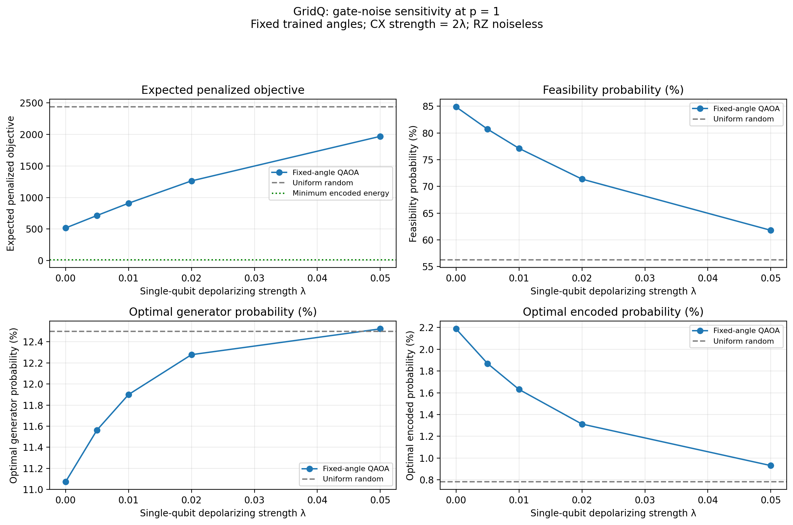

# GridQ: Generator Selection Using QAOA

This project was completed for submission to the **Interstate Quantum
Hackathon for Beginners 2026**, under the **QAOA track**, with
**Rising-star** as the requested category.

GridQ explores a small electricity-generator selection problem using
QAOA simulations, an exact classical baseline, and simulated gate noise.

An eight-qubit QAOA simulation for a small generator-selection problem,
with an exact classical reference, measurement sampling, and gate-noise analysis.

**Participant:** Kshitiz Khatiwada  
**Affiliation:** University of Arkansas at Monticello  
**Academic programs:** Computer Information Systems and Mathematics  
**Requested category:** Rising-star  
**Track:** QAOA  

## Project Summary

Choose which of four generators to select so that available capacity
meets demand at minimum fixed cost.

The exact minimum cost is **11**, achieved by either:

- Generators 2 and 3: selection `0110`.
- Generators 1 and 4: selection `1001`.

Selections are written in generator order 1–4.

The notebook encodes the problem using four generator bits and four
slack bits, validates the encoding, trains QAOA, and investigates noise.

## Main Results

At QAOA depth p = 1, the best of three training starts produced:

| Metric | Uniform random | Trained QAOA |
|---|---:|---:|
| Expected penalized objective | 2435.00 | 516.45 |
| Feasibility probability | 56.25% | 84.87% |
| Optimal generator probability | 12.50% | 11.07% |
| Optimal complete encoding probability | 0.78125% | 2.18739% |

Increasing gate noise reduced feasibility and optimal complete encoding
probability, while optimal generator probability moved toward its random
baseline. The apparent effect of noise therefore depended on the metric.

These are classical simulations of quantum circuits. The project does
not establish quantum speedup.



## Files

- `GridQ.ipynb`: main notebook, including explanations and executed results.
- `REPORT.md`: methodology, labeled figures, results, and discussion.
- `requirements.txt`: pinned Python dependencies.
- `results/`: figures, measurement counts, noise data, and experiment settings.
- `classical_baseline.py`: original classical generator-selection script.
- `encoded_baseline.py`: classical enumeration of the penalty-and-slack encoding;
- `Work_Log.md`: development record.

## Running the Project

The recorded local run used Python 3.9.6. That Python version is deprecated
by Qiskit; the package versions below describe the environment used here.

Create and activate a virtual environment:

```bash
python3 -m venv .venv
```

On macOS or Linux:

```bash
source .venv/bin/activate
```

On Windows Command Prompt:

```bat
.venv\Scripts\activate.bat
```

Install dependencies:

```bash
python -m pip install -r requirements.txt
python -m pip check
```

Open `GridQ.ipynb` in VS Code with the Python and Jupyter extensions.
Select the project virtual environment as the notebook kernel, then
run the cells from top to bottom.

The notebook includes a package-install command at the beginning.
It creates the `results` directory and writes its output files automatically.

No IBM Quantum account, API token, or quantum hardware is required.

## Reproducibility

- QAOA depth: 1.
- Training seeds: 42, 43, 44.
- COBYLA budget: 200 objective evaluations per start.
- Selected training seed: 44.
- Measurement shots: 4,096.
- Sampling seed: 2026.
- Transpiler seed: 42.
- Noise strengths: 0, 0.005, 0.01, 0.02, 0.05.
- Noise: λ after SX/X gates, 2λ after CX gates, and none after RZ gates.
- Angles remain fixed during the noise sweep.
- Noise probabilities are obtained directly by density-matrix simulation.

## AI Assistance

I configured the local environment, executed the classical and quantum
simulations in VS Code, collected the outputs, and assembled the submission.

ChatGPT assisted while writing code, finding resources, and documentation
drafts, and helped interpret the results. Claude assisted with grammar
and paraphrasing.

## References

- Organizer-provided QAOA training notebook:
  https://github.com/iq-hackathon/IQ-Hackathon-Fall-2026-Beginners
- Qiskit documentation:
  https://quantum.cloud.ibm.com/docs/
- Qiskit Aer documentation:
  https://qiskit.github.io/qiskit-aer/
- SciPy optimization documentation:
  https://docs.scipy.org/doc/scipy-1.13.1/reference/optimize.html
- Lucas A (2014) Ising formulations of many NP problems. Front. Physics 2:5. doi: 10.3389/fphy.2014.00005
- https://doi.org/10.48550/arXiv.1811.11538
- https://doi.org/10.48550/arXiv.1411.4028