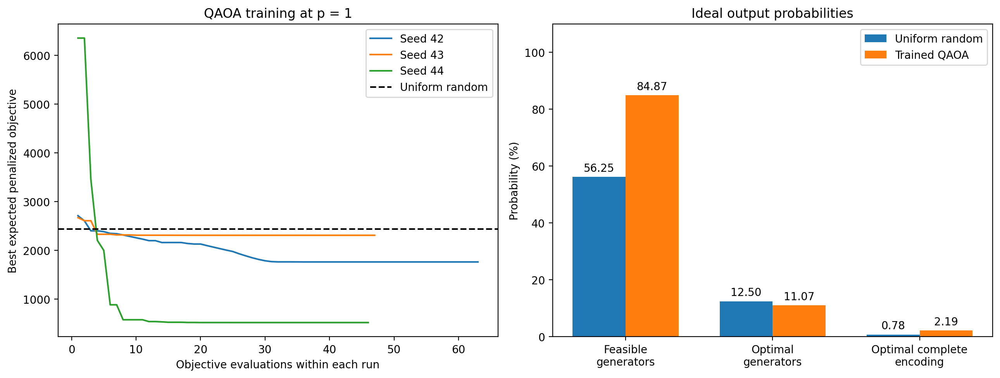

# GridQ: Generator Selection Using QAOA

## Participant Information

- Group name: GridQ
- Participant: Kshitiz Khatiwada
- Affiliation: University of Arkansas at Monticello
- Academic programs: Computer Information Systems and Mathematics
- Department(s): School of CIS, and School of Natural Science and Mathematics
- Career level: Undergraduate student
- Track: QAOA
- Requested category: Rising-star; final classification is determined by the committee

## Summary of Work

- Defined a four-generator selection problem with a capacity constraint.
- Found the exact classical optimum by checking all 16 generator selections.
- Encoded the constraint using four binary slack variables and a quadratic penalty.
- Verified agreement between the penalty expression, QUBO, and Ising formulation
  across all 256 encoded assignments.
- Built an eight-qubit QAOA circuit and trained it at depth p = 1.
- Compared ideal probabilities with 4,096 measurement samples.
- Investigated five depolarizing-noise strengths using fixed trained angles.
- Found that the apparent effect of noise depends on the evaluation metric.

## 1. Motivation and Problem

Choosing which electricity generators to make available involves balancing
cost against sufficient capacity. I study a small example that is easy to
interpret and can be checked exactly.

| Generator | Available capacity | Fixed selection cost |
|---|---:|---:|
| 1 | 2 | 3 |
| 2 | 4 | 5 |
| 3 | 5 | 6 |
| 4 | 7 | 8 |

Demand is 9 capacity units. Each generator is either selected or not selected.

The objective is to minimize:

C(x) = 3x₀ + 5x₁ + 6x₂ + 8x₃

subject to:

2x₀ + 4x₁ + 5x₂ + 7x₃ ≥ 9,

where each xᵢ is binary.

The data are synthetic. Selected capacity represents available capacity,
rather than a requirement to generate at full output. This model does not
include continuous power dispatch, operating schedules, or transmission constraints.

## 2. Classical Reference

Exhaustive enumeration checked all 16 generator selections, of which nine
were feasible.

There are two minimum-cost selections:

| Selection in generator order 1–4 | Selected generators | Capacity | Cost |
|---|---|---:|---:|
| 0110 | 2 and 3 | 9 | 11 |
| 1001 | 1 and 4 | 9 | 11 |

The exact minimum feasible cost is therefore 11.

## 3. QUBO and Ising Encoding

I introduce nonnegative slack to represent surplus capacity:

s = b₀ + 2b₁ + 4b₂ + 8b₃.

The maximum required surplus is 18 − 9 = 9. Four slack bits cover all
required values.

The penalized objective is:

F(x,b) = C(x) + 24(capacity − 9 − s)².
Citation : Glover, Kochenberger, and Du, “A Tutorial on Formulating and Using
QUBO Models” (2018), https://arxiv.org/abs/1811.11538.

A nonzero residual is an integer and therefore incurs a penalty of at
least 24. Selecting all generators costs 22 and admits zero residual.
Because selection costs are nonnegative, a nonzero-residual assignment
cannot minimize the encoded objective.

The encoding uses eight binary variables: four generator variables and
four slack variables. It therefore requires eight qubits.

I expanded the objective into constant, linear, and pairwise terms.
Then I applied yᵢ = (1 − Zᵢ)/2 to obtain an Ising Hamiltonian.

Citation : The alternating cost-and-mixer construction follows the QAOA framework
introduced by Farhi, Goldstone, and Gutmann, “A Quantum Approximate
Optimization Algorithm” (2014), https://arxiv.org/abs/1411.4028.

Checks across all 256 assignments confirmed agreement between the
original penalty expression, expanded QUBO, and Ising energies.
Both encoded ground-state assignments have energy 11.

## 4. QAOA Method and Code Workflow

The notebook proceeds through:

1. Environment installation and dependency checks.
2. Exact classical enumeration.
3. Slack-variable encoding and exhaustive validation.
4. QUBO expansion and Ising conversion.
5. QAOA circuit construction.
6. Ideal statevector training and evaluation.
7. Finite-shot measurement sampling.
8. Fixed-angle density-matrix noise simulation.
9. Plotting and saving results.

The circuit starts with Hadamard gates on all eight qubits. Each QAOA
layer applies RZ and RZZ cost rotations followed by RX mixer rotations.

I used depth p = 1. Nonconstant Hamiltonian coefficients were divided
by their largest absolute value for circuit construction. Reported
objective values remain in the original units.

COBYLA minimized the expected penalized objective divided by this
positive scaling factor. Three starting points used seeds 42, 43,
and 44, each with a budget of 200 objective evaluations.

I retained the lowest objective encountered within each run and selected
the best run using expected objective, rather than success probability.

For noise experiments, the selected circuit was compiled once into
RZ, SX, X, and CX gates with transpiler seed 42 and optimization level 1.

## 5. Tools Used

- Python 3.9.6
- Qiskit 2.2.3: circuit construction and compilation
- Qiskit Aer 0.17.2: sampling and noise simulation
- NumPy 2.0.2: numerical calculations
- SciPy 1.13.1: COBYLA optimization
- Matplotlib 3.9.4: figures
- VS Code and Jupyter: notebook editing and local execution

## 6. Ideal Training Results

| Starting seed | Objective evaluations | Best expected penalized objective |
|---:|---:|---:|
| 42 | 63 | 1759.81 |
| 43 | 47 | 2306.94 |
| 44 | 46 | 516.45 |

All three optimizer runs reported successful termination. This does
not certify a global minimum over the circuit parameters.

The selected run used seed 44:

- Gamma: 0.48971706106726154
- Beta: 2.7269697611688657

| Metric | Uniform random | Selected QAOA |
|---|---:|---:|
| Expected penalized objective | 2435.00 | 516.45 |
| Feasibility probability | 56.25% | 84.87% |
| Optimal generator probability | 12.50% | 11.07% |
| Optimal complete encoding probability | 0.78125% | 2.18739% |

Figure 1. Best objective encountered during each training run, and
probability metrics for the selected circuit versus uniform random assignments.

The expected objective decreased by approximately 78.8%. However,
optimal generator probability remained below the uniform baseline.
Minimizing expected penalized objective did not improve every metric.

## 7. Finite-Shot Sampling

I sampled the selected ideal circuit 4,096 times using simulator seed 2026.

| Metric | Ideal probabilities | Sampled estimate |
|---|---:|---:|
| Expected penalized objective | 516.4466 | 506.7761 |
| Feasibility | 84.87% | 84.35% |
| Optimal generators | 11.07% | 11.35% |
| Optimal complete encoding | 2.18739% | 2.05078% |

The two optimal generator pairs appeared in a combined 465 shots.
The most frequent generator selection was 1111, selecting all generators
at cost 22.

The sampled estimates were close to the ideal probabilities.
Finite-shot sampling variation explains why they do not match exactly.

## 8. Gate-Noise Experiment

I held the selected trained angles fixed and applied depolarizing noise:

- Strength λ after SX and X gates.
- Strength 2λ after CX gates.
- No error after RZ gates.
The depolarizing channel is defined in the

[Qiskit Aer documentation](https://qiskit.github.io/qiskit-aer/stubs/qiskit_aer.noise.depolarizing_error.html).
The gate-specific strengths above are modeling choices for this experiment.

This is a simplified model, not a calibration of a physical device.
Density-matrix simulation provided output probabilities directly,
without finite-shot sampling variation.

The compiled noiseless circuit and zero-noise density simulation were
checked against the original ideal probabilities.

| λ | Expected objective | Feasibility | Optimal generators | Optimal complete encoding |
|---:|---:|---:|---:|---:|
| 0.000 | 516.45 | 84.87% | 11.07% | 2.187% |
| 0.005 | 714.80 | 80.71% | 11.56% | 1.869% |
| 0.010 | 908.69 | 77.12% | 11.90% | 1.631% |
| 0.020 | 1262.58 | 71.37% | 12.28% | 1.313% |
| 0.050 | 1968.58 | 61.79% | 12.52% | 0.931% |

Figure 2. Four evaluation metrics as depolarizing strength increases.
Angles and compiled circuit remain fixed. Dashed lines show uniform
random baselines.

Noise increased expected penalized objective and reduced feasibility
and optimal complete encoding probability.

Optimal generator probability instead increased toward its uniform
baseline of 12.50%. Its value of approximately 12.52% at λ = 0.05
alone does not demonstrate an advantage.

These trends are consistent with mixing toward a more uniform
distribution. The summary metrics alone do not establish that the
full distribution becomes progressively closer to uniform.

## 9. Interpretation and Limitations

Generator success and complete encoded success measure different events.
An optimal generator pair can appear with incorrect slack bits and
therefore receive a penalty.

The main finding is that evaluating only optimal generator probability
could give a misleading impression of noise robustness. Feasibility,
encoded success, and expected objective provide additional information.

This study uses one small synthetic instance, depth p = 1, three training
starts, and a simplified noise model. The angles were not retrained under noise.

All quantum circuits were simulated on a classical computer.
The experiment does not establish quantum speedup or an advantage over
classical enumeration.

Possible extensions include comparing circuit depths, testing different
penalty strengths, and evaluating additional generator instances.

## 10. AI Assistance

I configured the local environment, executed the classical and quantum
simulations in VS Code, collected the outputs, and assembled the submission.

ChatGPT assisted while writing code, finding resources, and documentation
drafts, and helped interpret the results. Claude assisted with grammar
and paraphrasing.

## 11. References

- Organizer-provided QAOA training notebook:
  https://github.com/iq-hackathon/IQ-Hackathon-Fall-2026-Beginners
- Qiskit documentation:
  https://quantum.cloud.ibm.com/docs/
- Qiskit Aer documentation:
  https://qiskit.github.io/qiskit-aer/
- SciPy optimization documentation:
  https://docs.scipy.org/doc/scipy-1.13.1/reference/optimize.html
- Lucas A (2014) Ising formulations of many NP problems. Front. Physics 2:5. doi: 10.3389/fphy.2014.00005
- https://doi.org/10.48550/arXiv.1811.11538
- https://doi.org/10.48550/arXiv.1411.4028